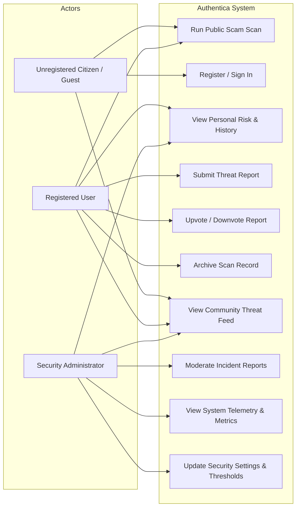
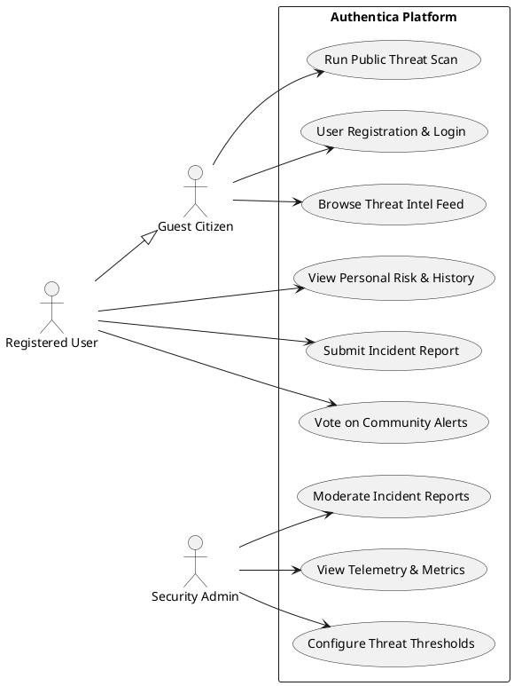
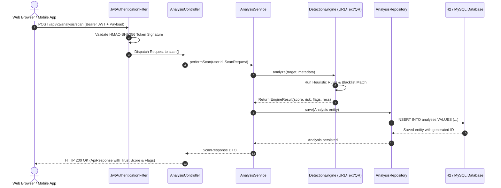
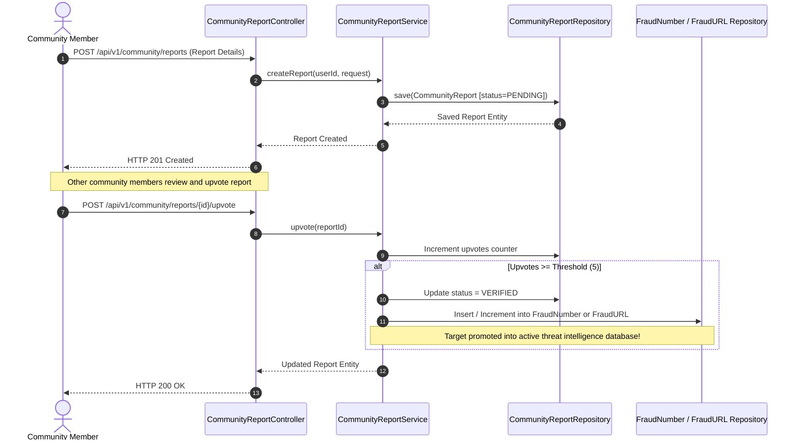
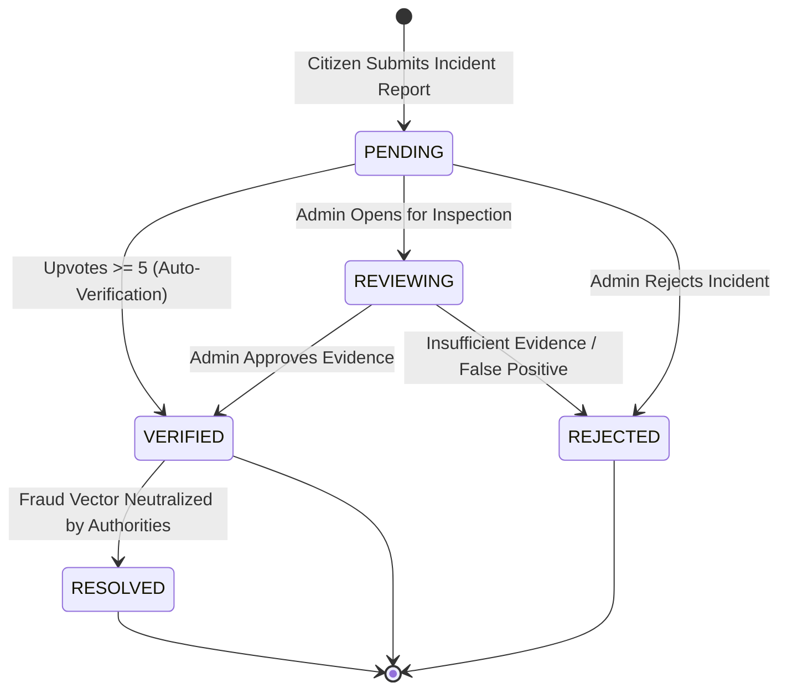
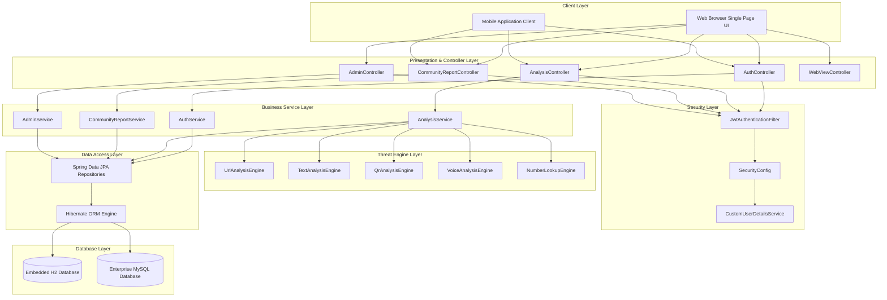

# Gujarat Technological University (GTU)
## Course: Advanced Java Programming (Subject Code: BE05000131)
### Semester: V | Academic Year: 2026-2027
---

# SYSTEM DESIGN & UML DIAGRAMS SPECIFICATION
## Project Name: Authentica Scam & Cyber Threat Detection Platform

This document details the architectural and behavioral UML diagrams for the Authentica Platform, fully aligned with the requirements in `02_SRS`. Diagrams are specified in standard **Mermaid** and **PlantUML** formats.

---

## 1. Use Case Diagram

The Use Case Diagram depicts the interactions between actors (Unregistered Citizen, Registered User, and Security Administrator) and system capabilities.



### PlantUML Representation:


---

## 2. Class Diagram

The Class Diagram illustrates the object-oriented structure, domain models, Spring Data repositories, service layer components, and detection engines.

```mermaid
classDiagram
    class User {
        -Long id
        -String name
        -String email
        -String password
        -String phone
        -Role role
        -Integer trustScore
        -RiskLevel riskLevel
        -Boolean isActive
        -LocalDateTime createdAt
    }

    class Analysis {
        -Long id
        -Long userId
        -AnalysisType type
        -AnalysisStatus status
        -Integer trustScore
        -RiskLevel riskLevel
        -Double confidence
        -String inputTarget
        -String summary
        -String detailsJson
        -Long processingTimeMs
        -Boolean isArchived
        -LocalDateTime createdAt
    }

    class CommunityReport {
        -Long id
        -Long userId
        -String reporterName
        -String type
        -String title
        -String description
        -String targetIdentifier
        -String tags
        -String city
        -String state
        -Integer upvotes
        -Integer downvotes
        -ReportStatus status
        -LocalDateTime createdAt
    }

    class FraudNumber {
        -Long id
        -String phoneNumber
        -Integer riskScore
        -String category
        -Integer reportCount
        -String description
    }

    class FraudURL {
        -Long id
        -String url
        -String domain
        -Integer riskScore
        -String category
        -String phishingIndicators
        -Integer reportCount
    }

    class FraudQR {
        -Long id
        -String qrContent
        -String qrType
        -Integer riskScore
        -String upiHandle
        -String merchantName
    }

    class UrlAnalysisEngine {
        +EngineResult analyze(String url)
    }

    class TextAnalysisEngine {
        +EngineResult analyze(String text, String sender)
    }

    class QrAnalysisEngine {
        +EngineResult analyze(String qrContent)
    }

    class VoiceAnalysisEngine {
        +EngineResult analyze(String audioUrl, Integer duration, String transcript)
    }

    class NumberLookupEngine {
        +EngineResult analyze(String phoneNumber)
    }

    class AnalysisService {
        -AnalysisRepository analysisRepo
        -UrlAnalysisEngine urlEngine
        -TextAnalysisEngine textEngine
        -QrAnalysisEngine qrEngine
        -VoiceAnalysisEngine voiceEngine
        -NumberLookupEngine numberEngine
        +ScanResponse performScan(Long userId, ScanRequest req)
    }

    User "1" --> "*" Analysis : owns
    User "1" --> "*" CommunityReport : submits
    AnalysisService ..> UrlAnalysisEngine : invokes
    AnalysisService ..> TextAnalysisEngine : invokes
    AnalysisService ..> QrAnalysisEngine : invokes
    AnalysisService ..> VoiceAnalysisEngine : invokes
    AnalysisService ..> NumberLookupEngine : invokes
    AnalysisService ..> Analysis : persists
```



---

## 3. Sequence Diagram: Multi-Modal Threat Scan

This Sequence Diagram traces the end-to-end execution of a threat scan request from the web/mobile client through Spring Security, the controller, the service layer, the heuristic detection engine, and the persistence repository.



---

## 4. Sequence Diagram: Community Report Submission & Auto-Sync



---

## 5. Activity Diagram: Heuristic Threat Inspection Workflow

```mermaid
flowchart TD
    Start([Receive Target Input]) --> TypeCheck{Input Modality?}
    
    TypeCheck -->|URL / Link| U1[Parse Host & Path]
    U1 --> U2{In Whitelist?}
    U2 -->|Yes| Safe[Assign SAFE Rating & Score >= 90]
    U2 -->|No| U3{In Blacklist DB?}
    U3 -->|Yes| FlagBlacklist[Flag Matched Blacklist (+90 Threat)]
    U3 -->|No| U4[Check Suspicious TLD / IP / Typosquatting / Keywords]
    U4 --> Calc[Calculate Threat & Deduct Trust Score]
    
    TypeCheck -->|SMS / Text| T1[Inspect Psychological Urgency Phrases]
    T1 --> T2[Check Financial Lure & Credential Traps]
    T2 --> T3[Verify TRAI DLT Sender ID Format]
    T3 --> Calc
    
    TypeCheck -->|QR Code| Q1{Starts with upi://pay?}
    Q1 -->|Yes| Q2[Extract Payee VPA & Merchant Parameters]
    Q2 --> Q3{Contains 'Claim Refund' Note?}
    Q3 -->|Yes| FlagFraud[Flag Deceptive Debit Trap (+50 Threat)]
    Q3 -->|No| Q4[Verify Payee VPA in Fraud DB]
    Q4 --> Calc
    Q1 -->|No URL| U1
    
    TypeCheck -->|Phone Number| P1[Normalize Number (+91)]
    P1 --> P2{Found in Fraud DB?}
    P2 -->|Yes| P3[Retrieve Carrier, Spam Tags & Report Count]
    P2 -->|No| P4[Evaluate Spoofing & Prefix Heuristics]
    P3 --> Calc
    P4 --> Calc
    
    FlagBlacklist --> Calc
    FlagFraud --> Calc
    
    Calc --> RiskEval{Trust Score >= 80?}
    RiskEval -->|Yes| R_Safe[Risk Level: SAFE]
    RiskEval -->|No| ScoreLow{Trust Score >= 40?}
    ScoreLow -->|Yes| R_Med[Risk Level: MEDIUM]
    ScoreLow -->|No| R_Crit[Risk Level: HIGH / CRITICAL]
    
    Safe --> Output([Return Engine Result & Recommendations])
    R_Safe --> Output
    R_Med --> Output
    R_Crit --> Output
```

---

## 6. State Machine Diagram: Community Incident Lifecycle



---

## 7. Component Diagram



---

## 8. Deployment Diagram

```mermaid
flowchart TB
    subgraph Client Device
        Browser[Modern Web Browser Chrome / Edge / Firefox]
    end

    subgraph Host Application Server (JVM)
        subgraph Embedded Apache Tomcat Container
            App[Spring Boot 3 Web Application: authentica-platform.jar]
            JVM[Java Virtual Machine 17 / 21]
        end
        subgraph In-Memory / File Storage
            H2DB[(Embedded H2 Engine: authenticadb)]
        end
    end

    subgraph External / Enterprise Tier (Optional)
        MySQLDB[(MySQL Server 8.0: authentica_db)]
        Telecom[TRAI / NCRP Threat Feeds]
    end

    Browser -- "HTTP/HTTPS (Port 8080)" --> App
    App -- "In-Process JDBC Connection" --> H2DB
    App -. "TCP/IP JDBC (Port 3306) [--spring.profiles.active=mysql]" .-> MySQLDB
    App -. "RESTful Outbound Queries" .-> Telecom
```
