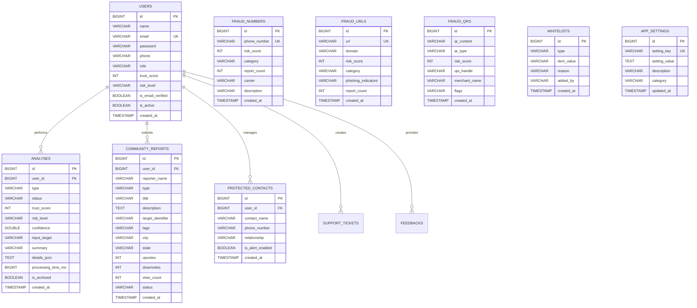

# Gujarat Technological University (GTU)
## Course: Advanced Java Programming (BE05000131)
### 05_Database: Database Documentation & Entity-Relationship Model

---

## 1. Database Architecture Overview
The Authentica Platform employs a decoupled persistence layer orchestrated by **Spring Data JPA** and **Hibernate ORM**.

- **Primary Mode (Zero-Config Academic Evaluation):** In-memory and file-based **H2 Database Engine** (`jdbc:h2:mem:authenticadb`). Requires zero software installation on the examiner's machine and automatically seeds users and threat data on startup.
- **Enterprise Production Mode:** **MySQL 8.0+** (`jdbc:mysql://localhost:3306/authentica_db`). Activated by appending `--spring.profiles.active=mysql`.

---

## 2. Entity-Relationship (ER) Diagram

---

## 3. Data Dictionary

### Table: `users`
| Column Name | Data Type | Nullable | Key | Description |
|---|---|---|---|---|
| `id` | BIGINT | No | PK | Auto-increment primary key |
| `name` | VARCHAR(255) | No | - | Citizen / administrator full name |
| `email` | VARCHAR(255) | No | UK | Unique login email address |
| `password` | VARCHAR(255) | No | - | BCrypt salted hash of user password |
| `phone` | VARCHAR(50) | Yes | - | Registered mobile phone number |
| `role` | VARCHAR(50) | No | - | Security role (`ROLE_USER` or `ROLE_ADMIN`) |
| `trust_score` | INT | No | - | Cyber hygiene score (0–100, default 85) |
| `risk_level` | VARCHAR(50) | No | - | Exposure category (`SAFE`, `LOW`, `MEDIUM`, `HIGH`, `CRITICAL`) |
| `is_active` | BOOLEAN | No | - | Account status flag |

### Table: `analyses`
| Column Name | Data Type | Nullable | Key | Description |
|---|---|---|---|---|
| `id` | BIGINT | No | PK | Scan audit primary key |
| `user_id` | BIGINT | Yes | FK | References `users(id)` (NULL for public scans) |
| `type` | VARCHAR(50) | No | - | Modality (`URL`, `TEXT`, `QR`, `VOICE`, `PHONE`) |
| `status` | VARCHAR(50) | No | - | `PROCESSING`, `COMPLETED`, `FAILED` |
| `trust_score` | INT | No | - | Calculated legitimacy score (0–100) |
| `risk_level` | VARCHAR(50) | No | - | Evaluated risk tier |
| `input_target`| VARCHAR(2000)| No | - | Target string inspected (URL, text, number, etc.) |
| `summary` | VARCHAR(4000)| No | - | Heuristic findings summary |
| `details_json`| TEXT | Yes | - | Serialized JSON containing flags & recommendations |
| `processing_time_ms` | BIGINT | No | - | Latency in milliseconds |

### Table: `community_reports`
| Column Name | Data Type | Nullable | Key | Description |
|---|---|---|---|---|
| `id` | BIGINT | No | PK | Incident report identifier |
| `user_id` | BIGINT | Yes | FK | Submitting user ID |
| `type` | VARCHAR(50) | No | - | Scam vector (`SMS`, `CALL`, `URL`, `UPI`, `EMAIL`) |
| `title` | VARCHAR(255) | No | - | Headline of fraud incident |
| `description` | TEXT | No | - | Narrative evidence and attacker instructions |
| `target_identifier` | VARCHAR(1000) | Yes | - | Phone number, URL, or UPI ID |
| `upvotes` | INT | No | - | Community endorsement count |
| `downvotes` | INT | No | - | Disputed vote count |
| `status` | VARCHAR(50) | No | - | `PENDING`, `VERIFIED`, `REJECTED`, `RESOLVED` |
