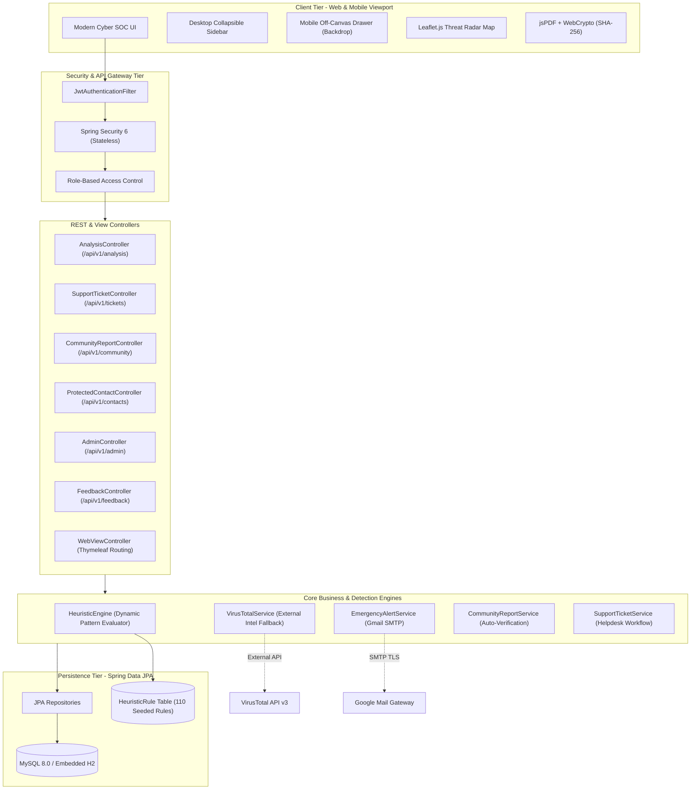
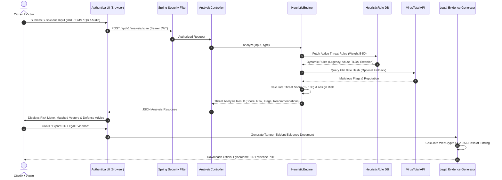
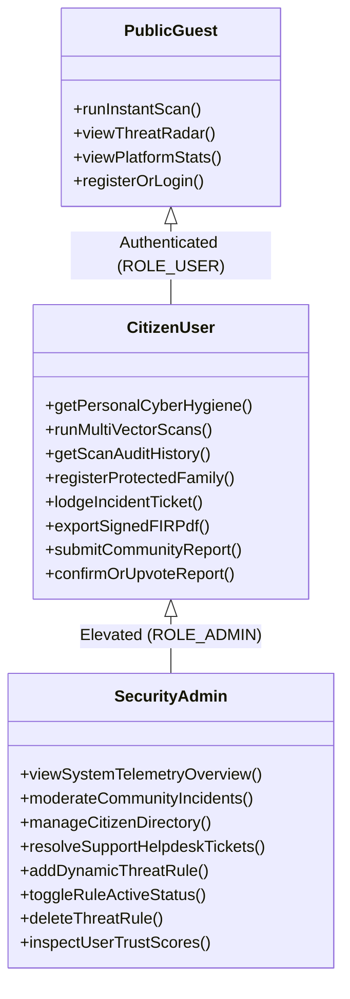

# Authentica: Enterprise Cyber Threat, Scam & Fraud Defense Platform
> **AI-Powered Multi-Vector Threat Intelligence, Heuristic Scam Engine & Citizen Defense SOC**  
> Built with **Spring Boot 3.3.4**, **Spring Security 6 (JWT)**, **Spring Data JPA**, **MySQL / H2**, and **Modern Cyber SOC UI**.

[](https://openjdk.org/)
[](https://spring.io/projects/spring-boot)
[](https://spring.io/projects/spring-security)
[](https://www.mysql.com/)
[](LICENSE)

---

## 📌 Executive Summary

**Authentica** is an enterprise-grade cyber defense and scam detection platform engineered to protect citizens and organizations against modern fraud vectors:
- 🌐 **Phishing Links & Malicious TLDs**: Domain typosquatting, credential harvesting, and deceptive brands.
- 💬 **SMS & Text Lures**: Urgent utility/electricity disconnection threats, lottery prizes, and loan approvals.
- 📱 **Deceptive UPI QR Codes**: Fraudulent "claim refund" transaction notes tricking victims into authorizing reverse debits.
- 🎙️ **Digital Arrest & Extortion Calls**: Impersonation of CBI, Police, FedEx, and customs officers demanding immediate transfer of funds.
- 📞 **Fraudulent Contact Numbers**: Cross-referenced against crowdsourced fraud registries and blacklists.

The platform provides **instant heuristic threat analysis**, a **dynamic 110-rule detection engine (stored in MySQL)**, **crowdsourced community radar intelligence**, **tamper-evident SHA-256 signed FIR Legal Evidence PDF generation**, and a **Family Emergency Shield**.

---

## 🏗️ System Architecture



---

## 🔄 Threat Detection & Workflow Sequence



---

## 👥 Role-Based Access Control (RBAC) Architecture

Authentica enforces the **Principle of Least Privilege (PoLP)** and **Separation of Duties** between victims/citizens and security administrators:



### Detailed Role Feature Matrix

| Feature Module | Unauthenticated Guest | Citizen (`ROLE_USER`) | Security Admin (`ROLE_ADMIN`) | Design Decision / Security Rationale |
|---|:---:|:---:|:---:|---|
| **Multi-Vector Threat Scanner** |  Quick Scan (Unsaved) |  Full Scan + Audit Trail |  Full Scan + Audit Trail | Guests can evaluate safety immediately; logged-in users build an audit history. |
| **Cyber Hygiene Posture Score** |  No |  **Personal Score (e.g. 96/100)** |  System Platform Telemetry | Citizens receive a gamified vulnerability rating; Admins track platform-wide trends. |
| **Cyber Incident Helpdesk** |  No |  **`+ Lodge Ticket`** |  **Queue Review & Status Resolution** | **Admins do NOT lodge complaints against themselves**; they operate as the resolving authority. |
| **Family Emergency Shield** |  No |  **`+ Add Contact` (Father, Mother, etc.)** |  Read-Only Audit | Citizens monitor elderly relatives against digital arrest scams. |
| **FIR Legal Evidence PDF Export** |  No |  **Yes (SHA-256 Tamper-Proof)** |  **Yes** | Generated client-side with cryptographic hash for filing cyber police reports. |
| **Community Threat Feed** |  Read-Only |  Submit Alert & Upvote |  **Verify (`VERIFIED`) or Delete** | Crowd reports require 5 upvotes or Admin action to achieve verified radar status. |
| **Dynamic Threat Rules Console** |  No |  No |  **Full Control (Add/Toggle/Delete)** | Normal users cannot tamper with heuristic weights or detection regexes. |
| **Citizen Account Directory** |  No |  No |  **Full Access (Trust scores & roles)** | Protected administrative registry for user management. |

---

## ⚡ Core Technical Innovations

### 1. Dynamic Heuristic Engine (110 Seeded Rules in DB)
Unlike legacy scanners that rely on hardcoded static keywords, Authentica stores all threat detection rules in MySQL:
- **`URL_KEYWORD`**: Brand spoofing (`netflix-login`, `sbi-netbanking`, `kyc-verify`).
- **`SUSPICIOUS_TLD`**: High-abuse domains (`.top`, `.xyz`, `.buzz`, `.live`, `.cam`).
- **`SMS_URGENCY`**: Coercion tactics (`electricity will be disconnected`, `within 24 hours`).
- **`SMS_FINANCIAL_LURE`**: Lottery and work-from-home lures (`credited Rs 50,000`, `daily payout`).
- **`VOICE_EXTORTION`**: Digital arrest keywords (`parcel confiscated by customs`, `CBI court summons`).
- **`QR_DECEPTIVE`**: Fake transaction note cues (`Receive Cashback`, `Refund authorization`).

> [!TIP]
> Administrators can add new patterns or toggle false positives in real time from `/admin#rules` without touching backend code or restarting the server.

### 2. Tamper-Evident FIR Legal Evidence Export
- Generates a court-admissible PDF document using `jsPDF`.
- Computes a client-side **SHA-256 cryptographic digest** using the native browser **Web Crypto API (`window.crypto.subtle`)**.
- Embeds verified scan metadata, target lure, matched threat indicators, risk level, and unique incident ID for submission to cybercrime cells.

### 3. Family Emergency Shield & Email Dispatcher
- Allows citizens to register emergency family contacts.
- Integrated with **Spring Mail (Gmail SMTP over TLS port 587)** to automatically dispatch emergency alerts when extortion calls or digital arrest threats are intercepted.

### 4. Fully Responsive Cyber SOC Interface
- Built with custom design tokens in [tokens.css](file:///d:/app/Ajava_project/Ajava/ajava/src/main/resources/static/css/tokens.css).
- **Desktop**: Collapsible sidebar with smooth layout expansion.
- **Mobile & Tablet**: Smooth off-canvas drawer with backdrop blur overlay, tap-outside-to-close, and keyboard `Escape` handling.
- **Dynamic Hamburger Toggle**: Icon dynamically transitions between **`☰`** (closed) and **`✕`** (open).

---

## 🚀 Quickstart & Setup

### Prerequisites
- **Java 17+** (JDK 17 or higher)
- **Apache Maven 3.8+** (or use bundled wrapper)
- **MySQL 8.0+** (optional; defaults to embedded H2)

### 1. Clone the Repository & Navigate
```bash
git clone https://github.com/prins000/Ajava.git
cd Ajava/ajava
```

### 2. Run the Application

#### Option A: Embedded H2 Database (Zero Config)
```bash
mvn clean spring-boot:run
```

#### Option B: Production MySQL
1. Ensure MySQL is running on `localhost:3306` with database `authentica_db`:
   ```sql
   CREATE DATABASE authentica_db CHARACTER SET utf8mb4 COLLATE utf8mb4_unicode_ci;
   ```
2. Launch with the `mysql` profile:
   ```bash
   mvn clean spring-boot:run -Dspring-boot.run.profiles=mysql
   ```

### 3. Access in Browser
👉 Open **`http://localhost:8080/`**

---

## 🔑 Pre-Seeded Demonstration Accounts

| Role | Email | Password | Access Highlights |
|---|---|---|---|
| **Security Administrator** | `admin@authentica.io` | `Admin@1234` | SecOps Telemetry, Moderation Queue, Citizen Directory, Helpdesk Resolution, 110 Threat Rules Console |
| **Citizen User** | `user@authentica.io` | `User@1234` | 96/100 Hygiene Score, Threat Scanner, Emergency Family Shield, Lodge Cybercrime Ticket, FIR PDF Export |
| **Database Console (H2)** | `http://localhost:8080/h2-console` | JDBC: `jdbc:h2:mem:authenticadb`<br>User: `sa`, Password: *(blank)* | SQL Inspection |

---

## 🔌 Complete REST API Reference

| Method | Endpoint | Authorization | Description |
|---|---|---|---|
| `POST` | `/api/v1/auth/register` | Public | Register citizen account |
| `POST` | `/api/v1/auth/login` | Public | Authenticate and obtain JWT token |
| `GET` | `/api/v1/auth/me` | Authenticated | Fetch current user session profile |
| `POST` | `/api/v1/analysis/scan-public` | Public | Anonymous quick scan |
| `POST` | `/api/v1/analysis/scan` | Authenticated | Threat scan with audit trail logging |
| `GET` | `/api/v1/analysis/history` | Authenticated | Paginated scan audit history |
| `DELETE` | `/api/v1/analysis/{id}` | Authenticated | Archive specific scan entry |
| `GET` | `/api/v1/contacts` | Authenticated | List protected family shield contacts |
| `POST` | `/api/v1/contacts` | Authenticated | Register new emergency family contact |
| `DELETE` | `/api/v1/contacts/{id}` | Authenticated | Remove protected contact |
| `POST` | `/api/v1/tickets` | Authenticated | Lodge new cybercrime assistance ticket |
| `GET` | `/api/v1/tickets/my` | Authenticated | Citizen: List my lodged support tickets |
| `GET` | `/api/v1/tickets/admin` | `ROLE_ADMIN` | Admin: Review all citizen support tickets |
| `PATCH`| `/api/v1/tickets/{id}/status` | `ROLE_ADMIN` | Admin: Update ticket status (`IN_PROGRESS` / `RESOLVED`) |
| `GET` | `/api/v1/community/feed` | Public | Verified crowdsourced incident alerts |
| `POST` | `/api/v1/community/reports` | Authenticated | Submit community fraud incident report |
| `POST` | `/api/v1/community/reports/{id}/upvote` | Public | Confirm/upvote threat report |
| `GET` | `/api/v1/admin/analytics` | `ROLE_ADMIN` | Fetch live platform telemetry |
| `GET` | `/api/v1/admin/users` | `ROLE_ADMIN` | Paginated registered citizen directory |
| `GET` | `/api/v1/admin/reports` | `ROLE_ADMIN` | Incident moderation queue |
| `PATCH`| `/api/v1/admin/reports/{id}/status` | `ROLE_ADMIN` | Verify or reject incident report |
| `GET` | `/api/v1/admin/rules` | `ROLE_ADMIN` | Fetch dynamic heuristic threat rules |
| `POST` | `/api/v1/admin/rules` | `ROLE_ADMIN` | Register new scam pattern into engine |
| `PATCH`| `/api/v1/admin/rules/{id}/toggle` | `ROLE_ADMIN` | Toggle rule active/disabled state |
| `DELETE`| `/api/v1/admin/rules/{id}` | `ROLE_ADMIN` | Delete heuristic rule from engine |

---

## 🎤 Interview & Project Presentation Guide (Viva Voce)

### 30-Second Elevator Pitch
> *"Authentica is a full-stack cybersecurity platform built with Spring Boot 3 and Spring Security 6. It tackles emerging financial and social engineering threats like digital arrest extortion, deceptive UPI QR scams, and phishing SMS messages.
>
> It features a dynamic 110-rule heuristic engine stored in MySQL, crowdsourced threat verification, an automated Family Emergency Shield, and client-side SHA-256 signed FIR legal evidence generation, structured around strict Role-Based Access Control between Citizens and SecOps Admins."*

### Key Technical Questions & Answers

#### Q1: Why did you use a database-driven Heuristic Engine instead of hardcoded regexes?
> **Answer:** In cybersecurity, attack vectors evolve daily. Hardcoded patterns require recompilation, testing, and service redeployment. With our database-driven engine, administrators can register new phishing keywords, abuse TLDs, or extortion phrases through the admin console, and the engine immediately evaluates them in real time.

#### Q2: Why is there an architectural separation between `ROLE_ADMIN` and `ROLE_USER`?
> **Answer:** We adhere to the **Principle of Least Privilege (PoLP)** and **Separation of Duties**. Citizens are protected victims who file complaints, run scans, and register family contacts. Administrators are the governing defense body; they do not lodge citizen complaints against themselves, but rather moderate the community queue, resolve tickets, and tune the detection engine.

#### Q3: How is the FIR Evidence PDF protected against tampering?
> **Answer:** Before generating the PDF, the browser uses the **Web Crypto API (`window.crypto.subtle`)** to compute a **SHA-256 digital cryptographic hash** over the evidence parameters (target, timestamp, engine findings, threat score). The generated PDF includes this tamper-evident hash alongside official verification metadata for submission to cybercrime authorities.

#### Q4: How does the application handle mobile responsiveness without third-party frameworks like Bootstrap or Tailwind?
> **Answer:** We built a custom design token system in vanilla CSS using CSS Grid and Flexbox. On desktops, the sidebar collapses smoothly to provide maximum screen real-estate for tables. On mobile screens, the sidebar transitions into an off-canvas drawer with a blurred backdrop, closing on backdrop tap, link tap, or Escape key press, with touch-scrolled tables that maintain structure across all devices.

---

## 📄 License
This project is licensed under the Apache License 2.0 - see the [LICENSE](LICENSE) file for details.
